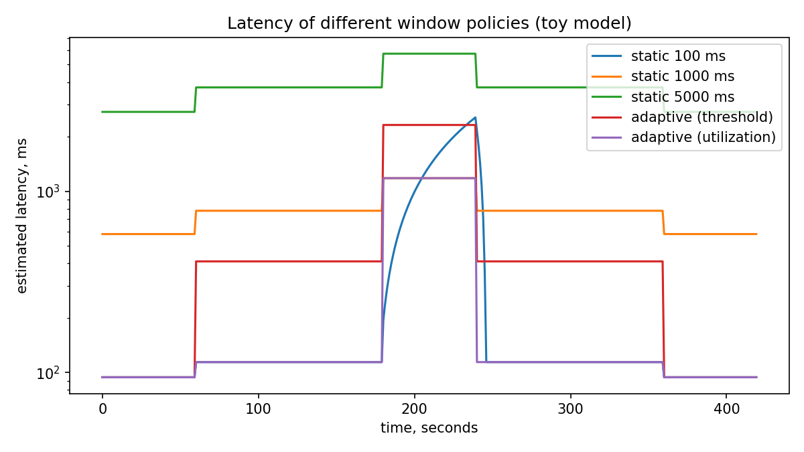

# stream-window-sim

[](https://github.com/Rainfallq/apsd-ass3/actions/workflows/ci.yml)

A small Python tool that compares fixed and adaptive window sizes for stream
processing. I wrote it as a practical part for the course Applied Software
Development, and it is based on one idea from my master's thesis about
real-time financial transaction monitoring.

## What problem does it look at?

A stream processor groups incoming transactions into windows. A small window
gives fast reaction, but every window has a fixed cost, so under heavy load the
worker can fall behind. A big window is cheap, but every transaction waits
longer. The question is whether the window size should change together with the
load.

## What is inside

| Part | File | What it does |
|------|------|--------------|
| Policies | `src/streamwin/adaptive.py` | static, threshold and utilization based window choice |
| Load | `src/streamwin/loadgen.py` | load profiles and fake transactions with a fixed seed |
| Model | `src/streamwin/simulator.py` | simple model of backlog and latency |
| Chart | `src/streamwin/plotting.py` | latency chart with matplotlib |
| CLI | `src/streamwin/cli.py` | runs everything and prints a table |

## Install and run

```bash
git clone https://github.com/Rainfallq/apsd-ass3.git
cd stream-window-sim
python -m venv .venv
source .venv/bin/activate        # on Windows: .venv\Scripts\activate
pip install -e ".[dev]"

python -m streamwin.cli --out docs/latency.png
pytest --cov=streamwin
ruff check .
```

## Example result

```
policy                        avg ms        max ms   overloaded s
static 100 ms                  609.3        2554.0             60
static 1000 ms                 922.9        1180.0              0
static 5000 ms                4454.3        5740.0              0
adaptive (threshold)          1122.6        2320.0              0
adaptive (utilization)         519.1        1180.0              0
```



How to read it: the 100 ms window is fine on average but gets overloaded for
60 seconds during the peak. The simple threshold rule avoids overload, but its
windows are too big in the middle load range, so its average is worse than a
fixed 100 ms window. The utilization based policy has the best average and no
overload.

## Important limits

This is a toy model. The costs (40 ms per window, 0.08 ms per transaction) are
assumptions, not measurements from Kafka. The numbers show how the policies
behave in this model and should not be quoted as real benchmark results.

## Project structure

```
src/streamwin/   source code
tests/           pytest tests
docs/            chart
.github/         CI workflow and issue templates
```

## Contributing

Open an issue first if you want to change something big. Before a pull request
please run `ruff check .` and `pytest`. The CI runs the same commands.

